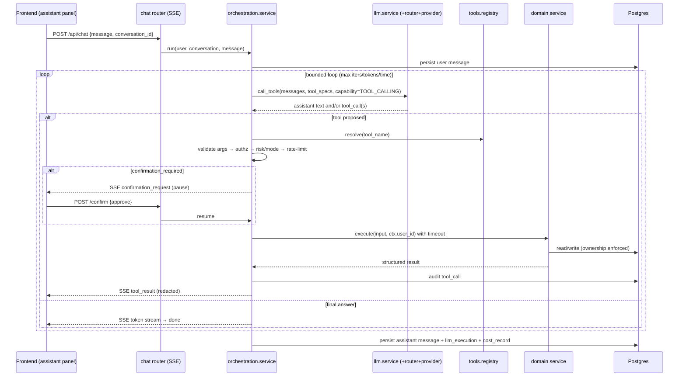

# 01 — Target architecture & request flow

> How the assistant is wired once tools land. B1/B2 already built the left half
> (provider + chat); B3 adds the `tools` and `orchestration` modules.

## 1. Module map

Two new bounded contexts join the modular monolith (phase-0 §11):

```
backend/app/modules/
  llm/            # provider abstraction, router, telemetry  (B1 — done)
  orchestration/  # the tool loop, budgets, HITL, tracing      (B3 — new)
  tools/          # tool registry + individual tool defs       (B3 — new)
  library/ books/ chapters/ reader/ audio/ downloads/ scraping/ (domain — exist)
```

### Dependency direction (never inverted)

```
router (chat)  ─►  orchestration.service  ─►  tools.registry ─► tool ─► domain.service
                          │                                              │
                          ├─► llm.service (capabilities, not models)     └─► repository ─► DB
                          └─► llm.telemetry / orchestration audit ─► DB
```

- The **orchestrator only ever calls tools** — never a domain service or repository
  directly. **[U]**
- A **tool wraps exactly one domain service method** and contains no business logic
  of its own. **[U]**
- Domain modules never import `llm`, `tools`, or `orchestration`. The arrow only
  points one way. **[U]**

## 2. End-to-end flow (one assistant turn with tools)



## 3. What is authoritative where

| Concern | Owner | Notes |
|---------|-------|-------|
| Intent → which tool + args | **LLM** | Only a proposal; never trusted to act |
| Arg validation | **tools/orchestration** | pydantic `input_schema` |
| AuthZ + ownership | **tool `authorize(ctx)`** | Independent of the model's claims |
| Risk / mode gating | **orchestration** | `internal_only` blocks external tools |
| Execution + result shape | **domain service + tool `output_schema`** | Backend is authoritative |
| Budgets / caps / cancel | **orchestration loop** | See [03](./03-orchestration.md) |
| Cost / trace of record | **llm.telemetry → Postgres** | See [05](./05-observability.md) |

## 4. `ToolContext` (the security spine)

Every tool receives a `ctx` carrying the authenticated identity and run metadata.
It is constructed by the orchestrator from the **session**, never from the model.

```python
@dataclass(frozen=True)
class ToolContext:
    user_id: UUID
    conversation_id: UUID
    run_id: UUID              # trace id for this orchestration run
    mode: Mode               # internal_only | external_allowed
    session: AsyncSession    # scoped per request
    now: datetime
```

The model can propose `book_id=<any uuid>`, but `authorize(ctx)` re-checks that the
row is owned by `ctx.user_id`. A tool must never read identity from its `input`.

## 5. Why two modules (`tools` vs `orchestration`)

- `tools/` is a **catalog**: declarative definitions + registry. Easy to unit test a
  tool in isolation (authz matrix, schema rejection) without a running loop.
- `orchestration/` is the **engine**: the loop, budgets, SSE protocol, HITL, tracing.
  It depends on `tools` and `llm`, but knows nothing about any specific tool.

This keeps the loop generic and lets us add tools (see the `add-llm-tool` skill)
without touching orchestration.

## 6. Reused patterns (from phase-0 §7)

- **SSE-first** streaming protocol carrying trace steps, text, HITL, and results.
- **HITL via interrupt + resume endpoint** with a max-rounds cap → maps directly to
  `confirmation_required` tools.
- **Executable-artifact safety:** treat any model-proposed action like untrusted
  output — parse, allowlist, authorize before executing.
