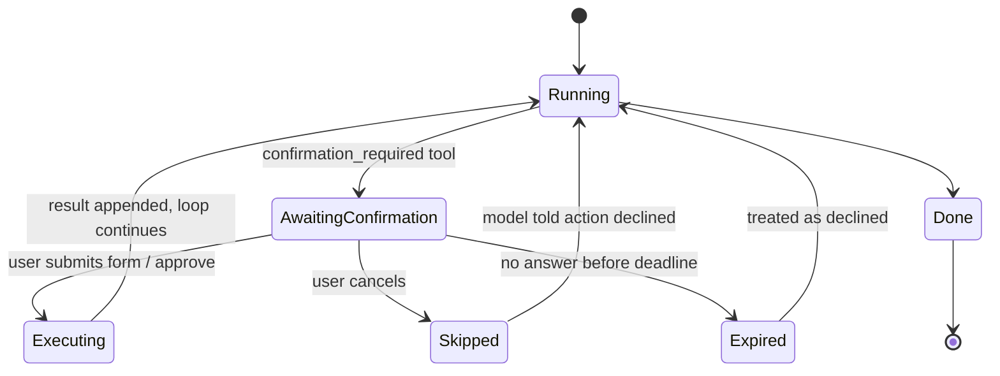

# 04 — Human-in-the-loop (HITL)

> Pauses the orchestrator when the user must decide something the model must not
> auto-execute. Per the north star ([00](./00-north-star.md)), HITL is **not** only
> Approve/Decline — it includes **structured forms**, and is distinct from **clarify /
> choice** questions in normal chat.

## 1. Two different “ask the user” modes **[R]**

| Mode | When | Executes a tool? | Transport |
|------|------|------------------|-----------|
| **Clarify / choice** | Intent unclear, or several valid options (which book?) | No (or only after a later turn) | Assistant prose + optional `choice_request` UI chips |
| **Confirmation (HITL)** | `confirmation_required` tool: destructive / expensive / external / import | Yes, only after user submits | `confirmation_request` + `POST /confirm` |

Untrusted book/tool text can never auto-approve a HITL gate. Clarify is conversational;
HITL is a **security and cost gate**.

## 2. What requires confirmation **[U]**

Anything **destructive, expensive, external, large-range, or an import**:

- Scrape a full book or a chapter range (external + costly).
- Overwrite or delete chapters/books (destructive).
- Create a large archive / full-book download.
- Access external websites / import an externally discovered book.
- Retry a large failed job (re-spends quota).

These are classified `risk_level = confirmation_required` on the tool
(see [02-tools.md](./02-tools.md)); the orchestrator enforces the pause.

## 3. Confirmation shapes **[R]**

### 3a. Binary (Approve / Decline)

Enough when args are fully known and safe to show as a summary
(“Delete *Book X* from your library?”).

### 3b. Form confirmation (structured params) — **required for north star**

When the user must supply or edit parameters before execute. Canonical example:

> Add this book to your library  
> - Starting chapter *(optional, default 1)*  
> - Amount of chapters to scrape *(empty = entire book)*  
> [OK] [Cancel]

The shipped audio-range form also exposes chapter range, provider, live voice choices,
and playback rate. SAPI defaults to Microsoft Zira Desktop at 1.35× in both the normal
download modal and assistant HITL.

Rules:

- The tool declares a **`confirmation_schema`** (pydantic) — fields the user may edit —
  separate from or a subset of `input_schema`.
- At pause time the orchestrator freezes a **proposal**: tool name, model-suggested
  args, and the form schema + defaults.
- On submit, the **user-edited values** become the args that are re-validated against
  `input_schema`. The model cannot swap in different args after the fact.
- Empty/optional fields use documented defaults (e.g. empty count → entire book).
- On approve, the orchestrator **re-runs the full execution contract** (validate →
  authz → risk/mode → rate-limit) before execute. Approval is not a bypass.

### 3c. Clarify / multi-choice (not a tool gate)

Examples: “Which of these five books?”, “Did you mean scrape or download?”

- Prefer assistant text; optionally emit `choice_request {options[]}` so the UI can
  render chips that send a normal user message (or a short-circuit follow-up).
- Choosing an option does **not** skip HITL if the next step is still
  `confirmation_required`.

## 4. Lifecycle



Also:

- A **max-rounds cap** limits how many HITL pauses one turn may request.
- Reject/expire → `tool_result(denied)` so the model can reply gracefully.

## 5. Transport **[D → ADR-8]**

SSE interrupt + resume endpoint (not websocket for B3):

1. Loop reaches a gated tool → emits `confirmation_request` (see payload below) and
   **suspends**; persists pending `tool_call`.
2. Frontend renders binary or **form** card from the schema.
3. `POST /api/chat/{conversation_id}/confirm` with
   `{ call_id, approved, values? }`.
4. Server resumes; new SSE stream continues the turn (`run_id` + `call_id` stitch).

`confirmation_request` ends the current SSE response (`awaiting_confirmation`). Confirm
opens a **new** SSE stream — avoids holding a socket open; survives reconnects.

### Payload (form-aware)

```json
{
  "type": "confirmation_request",
  "call_id": "…",
  "tool": "scrape_book_range",
  "risk": "confirmation_required",
  "summary": "Add «Book 2» to your library and scrape chapters",
  "args": { "discovered_book_id": "…", "start_chapter": 1, "chapter_count": null },
  "form": {
    "fields": [
      {
        "name": "start_chapter",
        "label": "Starting chapter",
        "type": "integer",
        "required": false,
        "default": 1
      },
      {
        "name": "chapter_count",
        "label": "Amount of chapters (empty = entire book)",
        "type": "integer",
        "required": false,
        "default": null
      }
    ]
  }
}
```

`choice_request` clarify chips are shipped; selecting one sends a normal user turn and
does not bypass any later confirmation gate.

Second form example — range audio download:

```json
{
  "type": "confirmation_request",
  "call_id": "…",
  "tool": "create_audio_download",
  "risk": "confirmation_required",
  "summary": "Generate MP3 for «Martial Peak» chapters 5–12",
  "args": {
    "book_id": "…",
    "chapter_from": 5,
    "chapter_to": 12,
    "provider": null,
    "voice": null,
    "rate": null
  },
  "form": {
    "fields": [
      {
        "name": "chapter_from",
        "label": "From chapter",
        "type": "integer",
        "required": true,
        "default": 5
      },
      {
        "name": "chapter_to",
        "label": "To chapter",
        "type": "integer",
        "required": true,
        "default": 12
      },
      {
        "name": "provider",
        "label": "TTS provider",
        "type": "string",
        "required": false,
        "default": null,
        "provided": false
      },
      {
        "name": "voice",
        "label": "Voice",
        "type": "string",
        "required": false,
        "default": null,
        "provided": false
      },
      {
        "name": "rate",
        "label": "Playback rate",
        "type": "number",
        "required": false,
        "default": null,
        "provided": false
      }
    ]
  }
}
```

Omitted provider/voice/rate (`provided: false`) inherit current reader settings; SAPI
defaults to Microsoft Zira Desktop at 1.35×.

## 6. Persistence

Reuse `tool_call`:

| Status | Meaning |
|--------|---------|
| `pending_confirmation` | Frozen proposal + form schema; `confirmed_by_user` null |
| `confirmed` | User approved; store **final** `input` (after form merge) |
| `rejected` / `expired` | Not executed |

`confirmed_by_user` feeds confirmation-rate metrics ([05](./05-observability.md)).

## 7. Frontend UX (B4)

- HITL + errors + user messages use **bubbles/cards**; assistant prose stays bubble-less
  markdown (current chat UX).
- Form card: labels, defaults, validation errors inline, **OK** / **Cancel**.
- Composer disabled (or clearly secondary) while a HITL card is open for that turn.
- After approval: remove the form; do not render a redundant “Approved” bubble.
- Render the authoritative tool outcome instead. Audio jobs show live progress,
  auto-download on completion, and keep a manual download button.
- After decline: a compact declined state is allowed while the resumed turn explains
  that no action ran.
- Clarify choices: chips preferred; sending a chip is just another user message.

## 8. Security notes

- Approval + form values come from the **authenticated session**, never from the model
  or from tool/book text.
- Re-validate ownership and schema at execute time.
- Rate-limit confirmations; cap form field sizes.
- Defaults must be safe (never “delete all” as a silent default).

## 9. Tests

- `confirmation_required` never executes without recorded confirmation.
- Form submit merges user values; model-only args without confirm are rejected.
- Tampered `call_id` / swapped tool name → rejected.
- Reject and expire paths clean.
- Ownership revoked between propose and approve → denied at execute.
- Optional empty `chapter_count` → service receives “entire book” semantics.
