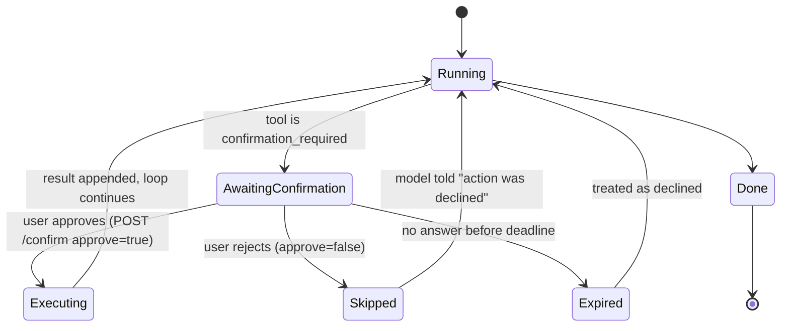

# 04 — Human-in-the-loop (HITL)

> `confirmation_required` tools must **pause** and get explicit user approval before
> executing. This is the single most important safety gate for destructive/expensive/
> external actions. Modeled on phase-0 §7's "interrupt + resume endpoint, max-rounds cap".

## 1. What requires confirmation **[U]**

Anything **destructive, expensive, external, large-range, or an import**:

- Scrape a full book or a large chapter range (external + costly).
- Overwrite or delete chapters/books (destructive).
- Create a large archive / full-book download.
- Access external websites / import an externally discovered book.
- Retry a large failed job (re-spends quota).

These are classified `risk_level = confirmation_required` on the tool itself
(see [02-tools.md](./02-tools.md)); the orchestrator enforces the pause.

## 2. Lifecycle

Key properties:

- The proposed **args are frozen** at pause time. The user approves the *exact* call
  shown; the model cannot swap args after approval.
- On approve, the orchestrator **re-runs the full execution contract** (validate →
  authz → risk/mode → rate-limit) before executing. Approval is not a bypass.
- On reject/expire, a `tool_result(denied)` is fed back so the model can respond
  gracefully ("I didn't start the download").
- A **max-rounds cap** limits how many confirmations one turn may request (prevents a
  model from spamming approval prompts).

## 3. Transport **[Q3]**

**Proposed (recommended):** keep the single SSE stream and add a resume endpoint.

1. Loop reaches a gated tool → emits `confirmation_request {call_id, tool, args, risk}`
   and **suspends** the run, persisting a pending record.
2. Frontend renders an approve/reject affordance in the chat.
3. Frontend calls `POST /api/chat/{conversation_id}/confirm { call_id, approved }`.
4. Server resolves the pending run and **resumes** the loop; new events continue on a
   (re-opened) SSE stream for that turn.

**Alternative:** a websocket for bidirectional messaging. Heavier; not needed for
single-user. Documented so the reviewer can push back.

### Resume across a suspended stream

Because plain SSE is one-directional and a suspended HTTP request is fragile, the
cleanest model is:

- The `confirmation_request` event ends the current SSE response with the run left in
  `awaiting_confirmation`.
- The `POST /confirm` starts a **new** SSE response that streams the continuation.
- The frontend stitches both into one visual turn using `run_id` + `call_id`.

This avoids holding a socket open indefinitely and survives client reconnects.

## 4. Persistence

A pending confirmation is durable so a refresh/reconnect doesn't lose it:

- Reuse `tool_call` with `status = 'pending_confirmation'`, `confirmed_by_user = null`,
  storing the frozen `input`.
- On approve → `status = 'confirmed'`, `confirmed_by_user = user_id`, then execute and
  update to `success`/`error`.
- On reject → `status = 'rejected'`. On expire → `status = 'expired'`.

`confirmed_by_user` gives us the confirmation-rate metric ([05](./05-observability.md))
and an audit trail of who approved what.

## 5. Frontend UX (B4)

- Render the pending action as a distinct **card with a bubble** (per the user's UI
  preference: HITL + errors + user messages get bubbles; assistant prose does not).
- Show tool name, a human summary of args ("Download chapters 1–120 of *X*"), and the
  risk level. Two buttons: **Approve** / **Decline**.
- Disable the composer while awaiting confirmation for that turn; show a clear
  "Waiting for your confirmation" state.
- After resolution, collapse the card into a compact "Approved/Declined" line.

## 6. Security notes

- The approval decision comes from the **authenticated session**, never from the model
  or from tool text. Untrusted content can never auto-approve.
- Re-validate ownership at execute time (the user may have lost access between propose
  and approve).
- Rate-limit confirmations to avoid approval-fatigue attacks.

## 7. Tests

- A `confirmation_required` tool never executes without a recorded `confirmed`.
- Reject path feeds `denied` back and the turn completes cleanly.
- Expire path behaves like reject.
- Args are immutable between propose and execute (tamper attempt → rejected).
- Ownership revoked between propose and approve → denied at execute.
